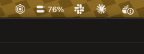

# Claude Usage

A macOS menu bar app that shows how much of your Claude plan you've used, the same numbers
claude.ai shows under **Settings → Usage**:

- **Current session**: the rolling 5-hour limit
- **This week**: the 7-day limit (plus per-model weekly limits when your plan has them)

The menu bar shows a two-bar gauge (session on top, week below) and a percentage. Click it to see
reset times and a pace estimate. From the gear menu you can choose which percentage the menu bar
shows, turn on launch at login, or open the usage page on claude.ai.



## Requirements

- macOS 14+
- Swift 6 toolchain (Xcode or Command Line Tools)
- [Claude Code](https://claude.com/claude-code) signed in with your Claude account (run `claude` once)

The app reads Claude Code's OAuth token from the `Claude Code-credentials` keychain item and calls
`https://api.anthropic.com/api/oauth/usage`. It refreshes every 5 minutes and when you open the panel
(if the data is over a minute old). That endpoint rate limits per token, and the token is shared with
Claude Code, so on a 429 the app keeps showing the last data and backs off (5 → 10 → 20 → 30 min).
If the token has expired, run `claude` in a terminal so it can refresh the token.

## Build & run

```sh
./scripts/build-app.sh            # builds build/Claude Usage.app
open "build/Claude Usage.app"

./scripts/build-app.sh --install  # also copies it to ~/Applications
```
